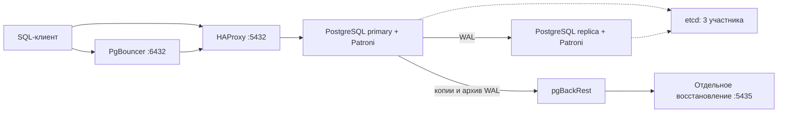

# Архитектура PostgreSQL для корпоративных систем

На курсе мы проектируем и разбираем PostgreSQL-систему на примере небольшой базы заказов.
Прослеживаем путь запроса от клиента через пул соединений до primary, наблюдаем репликацию,
проводим переключения и восстанавливаем данные. Каждый эксперимент заканчиваем объяснением
наблюдаемого поведения и проверкой состояния стенда.

Курс рассчитан на четыре учебных дня, с 10:30 до 17:00. Практику выполняем на одной
Ubuntu-ВМ в VirtualBox: компоненты размещены в отдельных контейнерах. Этого достаточно
для изучения механизмов PostgreSQL и Patroni. Отказ всей ВМ, физического диска или площадки
требует отдельной инфраструктуры и в этих опытах не воспроизводится.

## Подготовка к занятиям

Порядок установки и её параметры описаны в [инструкции стенда](pg-course/README.md).
Установку выполняем от root. После неё команды `labctl` запускаем в ВМ также от root.
Исходный репозиторий и рабочий каталог `/opt/pg-course` — разные каталоги:
в репозитории храним материалы, в рабочем каталоге — данные и конфигурацию конкретного стенда.

Для ВМ выделяем 2 vCPU, желательно 4 ГиБ RAM и диск 25–30 ГиБ. Минимум памяти — 3 ГиБ.
Начальный набор: 10 000 покупателей, 50 000 заказов и 150 000 позиций заказов.
Данные занимают десятки мегабайт. Нагрузочные опыты ограничены по времени и интенсивности;
генерация сотен гигабайт для курса не требуется.

Перед началом занятия:

```bash
labctl status
labctl check
labctl versions
```

`status` показывает фактические роли узлов. Primary может быть как `pg1`, так и `pg2`;
в упражнениях выбираем узел по его текущей роли.

## Устройство стенда



| Компоненты | Что изучаем | Память контейнера |
|---|---|---|
| `pg1`, `pg2` | PostgreSQL, streaming replication, Patroni, pgBackRest | По 512 МиБ |
| `etcd1`, `etcd2`, `etcd3` | Лидерство и кворум DCS | По 128 МиБ |
| `rw` | Маршрутизация HAProxy к текущему primary | 64 МиБ |
| `pool` | Transaction pooling в PgBouncer | 96 МиБ |
| `tools` | Кратковременные SQL-клиенты и проверки | 192 МиБ |
| `restore` | Независимое восстановление из копии и WAL | 384 МиБ |
| `exporter1`, `exporter2` | Метрики PostgreSQL | По 96 МиБ |
| `prometheus`, `grafana` | Сбор метрик и панель наблюдения | 192 и 256 МиБ |

Основные компоненты работают постоянно. Мониторинг и восстановленный экземпляр включаем
отдельно. На ВМ с 3 ГиБ RAM выполняем эти опыты по очереди. В PostgreSQL заданы
`shared_buffers=64MB`, `work_mem=2MB`, `max_connections=40`: обсуждаем их как настройки
маленькой лаборатории. Лимиты контейнеров не заменяют контроль потребления памяти.

Версии зафиксированы в [versions.json](pg-course/versions.json): PostgreSQL 18.6,
Patroni 4.1.5, etcd 3.7.3, HAProxy 3.4.7, PgBouncer 1.26.1, pgBackRest 2.60.0,
postgres_exporter 0.20.1, Prometheus 3.15.1 и Grafana 13.3.0.
Воспроизводим занятия на этом наборе; фактически установленные версии смотрим через `labctl versions`.

## Навигация по файлам

Файлы установки и сборки находятся в `pg-course/`. В таблице перечислены материалы,
с которыми работаем после подготовки ВМ, и вспомогательные файлы репозитория.

| Файл | Назначение и способ использования |
|---|---|
| [README.md](README.md) | Программа практики, команды и навигация по материалам |
| [pg-course/README.md](pg-course/README.md) | Установка и обновление стенда |
| [bin/labctl](pg-course/bin/labctl) | Управление стендом: SQL, переключения, режим репликации, копии, восстановление и диагностика. После установки доступен как `labctl` |
| [labs/01-diagnostics.sql](pg-course/labs/01-diagnostics.sql) | Параметры, размеры, сессии, ожидания, слоты, архивирование и `pg_stat_statements` |
| [labs/02-mvcc.sql](pg-course/labs/02-mvcc.sql) | Снимок REPEATABLE READ, видимость обновлений и VACUUM; выполняем блоками в двух сеансах |
| [labs/03-locks-a.sql](pg-course/labs/03-locks-a.sql) | Первый сеанс: удерживаем блокировку строки в открытой транзакции |
| [labs/03-locks-b.sql](pg-course/labs/03-locks-b.sql) | Второй сеанс: наблюдаем ожидание той же строки и срабатывание `lock_timeout` |
| [labs/04-plans.sql](pg-course/labs/04-plans.sql) | Сравниваем планы и буферы до и после добавления индекса |
| [labs/05-partitions.sql](pg-course/labs/05-partitions.sql) | Создаём две секции, добавляем 10 000 событий, проверяем отсечение секций |
| [labs/06-migration.sql](pg-course/labs/06-migration.sql) | Добавляем поле, заполняем порцию строк и строим индекс CONCURRENTLY; запускаем без общей транзакции |
| [labs/07-security.sql](pg-course/labs/07-security.sql) | Проверяем права ролей, TLS и правила HBA |
| [labs/workload.sql](pg-course/labs/workload.sql) | Транзакция чтения и изменения заказа для `labctl workload`; это сценарий pgbench, не обычный файл psql |
| [scripts/health.py](pg-course/scripts/health.py) | Проверки primary, streaming-реплики, TLS, маршрутизации, входа ролей и etcd; вызывается через `labctl check` и команды ожидания |
| [scripts/observe.py](pg-course/scripts/observe.py) | Клиент для переключений под записью: UUID операций, повтор неопределённой операции и журнал подтверждений COMMIT; `labctl observe` |
| [scripts/versions.py](pg-course/scripts/versions.py) | Сопоставляет версии бинарных файлов служебного образа с манифестом; `labctl versions` |
| [versions.json](pg-course/versions.json) | Единый манифест версий образов и пакетов |
| [tests/test_configure.py](pg-course/tests/test_configure.py) | Локальные проверки повторной настройки: сохранность данных и секретов, порты, профили и применение конфигурации HAProxy |
| [tests/test_seed_parameters.py](pg-course/tests/test_seed_parameters.py) | Проверяет параметризованные SQL-шаблоны наполнения без подключения к PostgreSQL |
| [.gitattributes](.gitattributes) | Окончания строк LF, необходимые в том числе для запуска Bash-файлов после клонирования из Windows |
| [.gitignore](.gitignore) | Исключает секреты, рабочие данные, журналы, архивы и служебные файлы из публикации |

`install.sh`, `image/`, `scripts/configure.py`, `scripts/preflight.py`, `scripts/seed.py`
и маркер `.pg-course-source` относятся к первоначальной подготовке. Для выполнения практикумов
отдельно запускать их не нужно.

Рабочие файлы создаются установщиком в `/opt/pg-course` и в Git не хранятся:

| Путь | Содержимое |
|---|---|
| `compose.json`, `config/` | Состав контейнеров, конфигурации сервисов и панель Grafana |
| `.env`, `certs/` | Пароли и учебные TLS-сертификаты; закрытые ключи остаются на ВМ |
| `data/pg1/18/docker`, `data/pg2/18/docker` | Данные PostgreSQL; внутри контейнеров — `/var/lib/postgresql/18/docker` |
| `data/restore/18/docker` | Данные отдельного восстановления |
| `data/etcd*`, `data/prometheus`, `data/grafana` | Состояние DCS и мониторинга |
| `backups/repo` | Физические копии и архив WAL pgBackRest |
| `backups/lock` | Рабочие блокировки pgBackRest |
| `logs/` | Журналы установки, сервисов и команд |
| `state/`, `generated/` | Блокировки команд, отметки применения конфигурации и файлы обслуживания |

## Подключения и роли

| Точка подключения | Порт ВМ |
|---|---|
| Текущий primary через HAProxy | `5432` |
| `pg1` / `pg2` напрямую | `5433` / `5434` |
| Восстановленный экземпляр | `5435` |
| PgBouncer | `6432` |
| Patroni REST `pg1` / `pg2` | `8008` / `8009` |
| Grafana / Prometheus | `3000` / `9090` |

Внутри контейнерной сети PostgreSQL использует `5432`, Patroni — `8008`, etcd — `2379` и `2380`.
На одном IP ВМ прямые порты двух PostgreSQL различаются. Наружу etcd и экспортёры не публикуются.

Учебная база — `course`. Пароли конкретной установки показывает `labctl credentials`.
Внешний SQL-клиент настраиваем с `sslmode=verify-full` и открытым сертификатом
`/opt/pg-course/certs/ca.crt`. Закрытый ключ CA клиенту не нужен. Адрес подключения должен
входить в сертификат; адрес первой установки добавляется в него автоматически.

| Роль | Назначение |
|---|---|
| `postgres` | Администрирование и диагностические упражнения |
| `course_owner` | Владелец учебных объектов без права входа |
| `course_migrator` | Изменение схемы, наследует права владельца |
| `course_app` | Прикладное чтение и изменение данных |
| `course_reader` | Чтение |
| `course_monitor` | Чтение и наблюдение, членство в `pg_monitor` |

`labctl sql` подключается как `postgres`. При проверке разграничения доступа отдельно
подключаемся внешним клиентом под нужной ролью.

## Практика по дням

### День 1. Диагностика, MVCC, блокировки и планы

Начинаем с устройства запроса и данных: находим процессы и настройки, сопоставляем
размер базы с таблицами и индексами, читаем сессии и ожидания.

```bash
labctl sql -f /labs/01-diagnostics.sql
labctl sql -f /labs/04-plans.sql
labctl workload 20
```

В опыте с индексом сравниваем `EXPLAIN (ANALYZE, BUFFERS)`, оценки строк и фактическое
чтение блоков. На маленькой таблице последовательное чтение может быть обоснованным.
При повторе опыта индекс уже существует: для исходного состояния в SQL-файле дана команда удаления.

Файлы `02-mvcc.sql` и `03-locks-*.sql` выполняем вручную по блокам в разных SQL-сеансах.
Проверяем, почему старый снимок видит прежнюю строку, что удерживает очистку версий и кто
блокирует UPDATE. В третьем сеансе смотрим `pg_stat_activity` и `pg_blocking_pids()`.
Для deadlock берём две строки: сеанс А блокирует заказ 1, Б — заказ 2, затем каждый
пытается обновить строку другого. После наблюдения завершаем транзакции через `ROLLBACK`.

Результат дня: по плану, ожиданиям и статистике объясняем причину замедления запроса.

### День 2. Репликация, переключения и кворум

Сначала находим primary и реплику, сопоставляем LSN и состояние streaming.
Запускаем клиент, который записывает идентификаторы операций и подтверждения COMMIT:

```bash
labctl status
labctl observe 60
```

Во втором SSH-сеансе выполняем `labctl switchover`. Затем повторяем опыт с остановкой
текущего primary: `labctl stop pg1` или `labctl stop pg2` по выводу `status`.
Возвращаем узел командой `labctl start pg1`/`pg2` и проверяем `labctl check`.
Обсуждаем время без подтверждений, повтор операции с тем же UUID и различие между
ошибкой соединения и однозначным исходом транзакции. Журнал сохраняется в `logs/commands/observe-*.log`.
Успешный прогон с асинхронной репликацией не гарантирует RPO=0 при других авариях.

```bash
labctl sync on
labctl sync strict
labctl sync off
```

Между сменами режима останавливаем реплику и наблюдаем доступность записи. В `strict`
COMMIT может ждать подтверждения реплики: возвращаем её из второго SSH-сеанса и наблюдаем
завершение ожидания `SyncRep`. Ограничение длительности клиента не отменяет уже начатый COMMIT.

Для опыта с отставанием выбираем фактическую реплику. Если это `pg2`:

```bash
labctl sql-node pg2 -c 'SELECT pg_wal_replay_pause();'
# Изменяем данные через primary, читаем реплику и сравниваем LSN.
labctl sql-node pg2 -c 'SELECT pg_wal_replay_resume();'
```

Отдельно останавливаем один etcd, проверяем доступность записи, возвращаем его. Затем
останавливаем два из трёх и наблюдаем потерю лидерства. Возвращаем оба участника через
`labctl start`, сохраняя их каталоги. Завершаем день с тремя работающими etcd,
streaming-репликой и `labctl sync off`.

### День 3. Копии, архив WAL и PITR

```bash
labctl backup
labctl backup-info
labctl restore
labctl restore-sql -c 'TABLE lab.restore_probe;'
```

Сравниваем исходную и восстановленную базы. Восстановление использует только
`data/restore`, не заменяет основной кластер и не переключает приложения.
У восстановленного экземпляра выключено архивирование в репозиторий исходного кластера.

Для следующего опыта удаляем только отдельное восстановление:

```bash
labctl restore-clean --confirm
```

Для PITR сначала создаём полную копию, затем выполняем команды по отдельности:

```bash
labctl sql -c "INSERT INTO lab.restore_probe(message) VALUES ('До ошибки');"
labctl sql -Atc 'SELECT clock_timestamp();'
# Сохраняем выведенный момент с часовым поясом: он должен быть после COMMIT и до DELETE.
labctl sql -c 'DELETE FROM lab.restore_probe;'
labctl sql -c "INSERT INTO lab.restore_probe(message) VALUES ('После ошибки');"
labctl sql -c 'SELECT pg_switch_wal();'
labctl sql -c 'SELECT * FROM pg_stat_archiver;'
```

Дожидаемся успешной архивации переключённого WAL. Затем подставляем сохранённый момент:

```bash
labctl restore --time '2026-11-02 12:34:56.123456+00:00'
labctl restore-sql -c 'TABLE lab.restore_probe;'
labctl sql -c 'TABLE lab.restore_probe;'
```

Время в примере заменяем результатом своего запроса. Проверяем, что восстановлена запись
«До ошибки», а «После ошибки» отсутствует. Если нужный момент не покрыт копией и архивом WAL,
разбираем `labctl logs restore`, а затем повторяем опыт с подходящей копией.

Для сравнения получаем логическую копию:

```bash
cd /opt/pg-course
docker compose -f compose.json run --rm --no-deps -T tools tool pg_dump -Fc course > backups/course.dump
```

Обсуждаем состав дампа, отдельное восстановление объектов и отличие от физической цепочки PITR.
pgBackRest хранит две полные копии; копирование по расписанию не включено. Метриками
контролируем рост архива и `pg_wal`: `max_wal_size` не задаёт жёсткий предел занимаемого места.

### День 4. Права, миграции, секционирование и эксплуатация

```bash
labctl sql -f /labs/07-security.sql
labctl sql -f /labs/06-migration.sql
labctl sql -f /labs/05-partitions.sql
labctl pool-sql -c 'SHOW POOLS;'
labctl pool-sql -c 'SHOW STATS;'
labctl monitoring on
```

Проверяем запрет записи для reader и право мигратора менять схему. Разбираем время удержания
DDL-блокировки, заполнение новой колонки порциями и `CREATE INDEX CONCURRENTLY`.
В секционированной таблице подтверждаем отсечение секций через план запроса.
В PgBouncer связываем число клиентских соединений с серверными и разбираем ограничения
состояния сеанса при transaction pooling.

В Grafana открываем панель «Учебный стенд PostgreSQL»: доступность, соединения, размер базы
и роль primary. Адрес — IP ВМ или `localhost` при SSH-туннеле, порт `3000`, пользователь `admin`,
пароль — из `labctl credentials`. Prometheus хранит метрики 24 часа с ограничением 128 МБ.
По окончании: `labctl monitoring off`.

Завершаем обсуждением major-обновления: проверка расширений и `pg_upgrade`, подготовка копии,
оценка простоя и план возврата. Основной кластер курса остаётся на PostgreSQL 18.
Полноценный Kubernetes и дополнительные major-версии в эту ВМ не устанавливаем.

## Завершение опытов и диагностика

После опытов возвращаем остановленные основные компоненты, возобновляем применение WAL
на реплике, завершаем открытые транзакции и выполняем `labctl sync off`, затем `labctl check`.
Для обычной остановки всего стенда используем `labctl down`, для запуска — `labctl up`.
Данные сохраняются. Мониторинг и восстановленный экземпляр включаются своими командами.

```bash
labctl logs pg1 100
labctl logs rw 100
labctl diagnose
```

PostgreSQL и Patroni пишут в `logs/pg1/service.log` и `logs/pg2/service.log`, остальные
сервисы — в `logs/ИМЯ/service.log`. pgBackRest пишет также в `logs/pg*/pgbackrest/`.
Вместо `docker logs` используем `labctl logs`: Docker logging driver у стенда отключён.
Ежедневный `pg-course-housekeeping.timer` ротирует сервисные журналы; установочные и
командные журналы старше семи суток удаляются. Для диагностики сохраняем нужный фрагмент
до очередной очистки. Секреты и необработанные журналы с чувствительными данными не публикуем.

Не удаляем `data/`, `backups/` и `.env`. Команда `restore-clean --confirm` удаляет только
отдельное учебное восстановление; для основного кластера такой команды сброса нет.

## Обновление ранней установки

В ранней редакции стенда были исправлены следующие места:

| Изменение | Где находится и зачем нужно |
|---|---|
| Остаток от деления через `mod()` в запросах наполнения | `scripts/seed.py`: SQL-оператор `%` конфликтовал с параметрами psycopg2 и вызывал `IndexError` |
| Явный `restore_command` для pgBackRest | `bin/labctl`, команда `restore`: чтение WAL больше не наследует промежуточный путь `/restore/18/docker`, недоступный запущенному восстановленному экземпляру |
| Обновление адресов PostgreSQL через DNS Docker | `scripts/configure.py`: HAProxy использует `127.0.0.11:53`, поэтому пересоздание контейнера с новым IP не оставляет старый backend |
| Применение изменённой конфигурации HAProxy | Генератор создаёт `state/reload-proxy`; установщик проверяет конфигурацию и перезапускает `rw`, после чего снимает отметку |
| Отключение фоновой предустановки и автообновления плагинов Grafana | В Compose задаются `GF_PLUGINS_PREINSTALL_DISABLED=true`, `GF_PLUGINS_PREINSTALL_AUTO_UPDATE=false` и `stop_grace_period=30s`; для панели курса достаточно встроенных компонентов |

Все эти изменения входят в текущий установщик. При первой установке дополнительные
ручные исправления не нужны. Уже работающий стенд обновляем из свежих исходников
по [инструкции повторного запуска](pg-course/README.md#повторный-запуск-и-обновление).
Изменения только внутри установленного `/opt/pg-course` не обновляют исходный репозиторий.

Если мониторинг был запущен до обновления, после установки выполняем:

```bash
labctl monitoring on
labctl check
```

Compose применит новые параметры Grafana при пересоздании контейнера. Если мониторинг
не нужен, оставляем его выключенным. Уже созданное ранней версией отдельное восстановление
для нового опыта очищаем через `labctl restore-clean --confirm` и создаём заново.
Резервные копии, выполненные переключения и контрольные записи учебных опытов не являются
изменениями конфигурации: их повторяем только в рамках соответствующего занятия.

После изменения шаблонов конфигурации локально проверяем затронутую часть:

```bash
python3 -m unittest discover -s pg-course/tests -p test_configure.py -v
```

Для изменения запросов наполнения — отдельно `test_seed_parameters.py` с тем же способом запуска.
Эти проверки используют временные каталоги, не запускают Docker и не подключаются к рабочей базе.

## Документация компонентов

- [PostgreSQL: руководство](https://www.postgresql.org/docs/18/).
- [Patroni: конфигурация](https://patroni.readthedocs.io/en/latest/yaml_configuration.html) и [режимы репликации](https://patroni.readthedocs.io/en/latest/replication_modes.html).
- [pgBackRest: руководство](https://pgbackrest.org/user-guide.html).
- [PgBouncer: режимы работы](https://www.pgbouncer.org/features.html).
- [HAProxy: руководство](https://docs.haproxy.org/).
