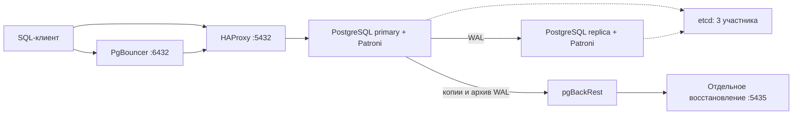

# Архитектура PostgreSQL для корпоративных систем

Материалы курса посвящены устройству PostgreSQL-систем: обработке запросов, MVCC,
репликации, переключениям, резервному копированию и эксплуатации.
Репозиторий содержит SQL-примеры, команды управления и стенд с небольшой базой заказов.

Компоненты стенда размещены в отдельных контейнерах на Ubuntu-ВМ в VirtualBox.

## Установка и рабочий каталог

Порядок установки и её параметры описаны в [инструкции стенда](pg-course/README.md).
Установку выполняем от root. После неё команды `labctl` запускаем в ВМ также от root.
Исходный репозиторий и рабочий каталог `/opt/pg-course` — разные каталоги:
в репозитории храним материалы, в рабочем каталоге — данные и конфигурацию конкретного стенда.

Начальный набор: 10 000 покупателей, 50 000 заказов и 150 000 позиций заказов.
Данные занимают десятки мегабайт. Требования к ВМ и параметры установки приведены
в инструкции стенда.

## Устройство стенда



| Компоненты | Назначение | Память контейнера |
|---|---|---|
| `pg1`, `pg2` | PostgreSQL, streaming replication, Patroni, pgBackRest | По 512 МиБ |
| `etcd1`, `etcd2`, `etcd3` | Лидерство и кворум DCS | По 128 МиБ |
| `rw` | Маршрутизация HAProxy к текущему primary | 64 МиБ |
| `pool` | Transaction pooling в PgBouncer | 96 МиБ |
| `tools` | Кратковременные SQL-клиенты и проверки | 192 МиБ |
| `restore` | Независимое восстановление из копии и WAL | 384 МиБ |
| `exporter1`, `exporter2` | Метрики PostgreSQL | По 96 МиБ |
| `prometheus`, `grafana` | Сбор метрик и панель наблюдения | 192 и 256 МиБ |

Мониторинг и восстановленный экземпляр управляются отдельными командами `labctl`.
В PostgreSQL заданы `shared_buffers=64MB`, `work_mem=2MB`, `max_connections=40`.

Версии компонентов указаны в [versions.json](pg-course/versions.json): PostgreSQL 18.6,
Patroni 4.1.5, etcd 3.7.3, HAProxy 3.4.7, PgBouncer 1.26.1, pgBackRest 2.60.0,
postgres_exporter 0.20.1, Prometheus 3.15.1 и Grafana 13.3.0.
Фактически установленные версии показывает `labctl versions`.

## Навигация по файлам

Файлы стенда находятся в `pg-course/`. В таблице перечислены SQL-примеры, инструменты
управления и вспомогательные файлы репозитория.

| Файл | Назначение и способ использования |
|---|---|
| [README.md](README.md) | Описание стенда, команды и навигация по материалам |
| [pg-course/README.md](pg-course/README.md) | Установка и обновление стенда |
| [bin/labctl](pg-course/bin/labctl) | Управление стендом: SQL, переключения, режим репликации, копии, восстановление и диагностика. После установки доступен как `labctl` |
| [labs/01-diagnostics.sql](pg-course/labs/01-diagnostics.sql) | Параметры, размеры, сессии, ожидания, слоты, архивирование и `pg_stat_statements` |
| [labs/02-mvcc.sql](pg-course/labs/02-mvcc.sql) | Снимок REPEATABLE READ, видимость обновлений и VACUUM; SQL-блоки для двух сеансов |
| [labs/03-locks-a.sql](pg-course/labs/03-locks-a.sql) | Сеанс А: удержание блокировки строки в открытой транзакции |
| [labs/03-locks-b.sql](pg-course/labs/03-locks-b.sql) | Сеанс Б: ожидание той же строки и срабатывание `lock_timeout` |
| [labs/04-plans.sql](pg-course/labs/04-plans.sql) | Планы и буферы до и после добавления индекса |
| [labs/05-partitions.sql](pg-course/labs/05-partitions.sql) | Две секции, 10 000 событий и отсечение секций |
| [labs/06-migration.sql](pg-course/labs/06-migration.sql) | Добавление поля, заполнение порции строк и индекс CONCURRENTLY с отдельными транзакциями команд |
| [labs/07-security.sql](pg-course/labs/07-security.sql) | Права ролей, TLS и правила HBA |
| [labs/workload.sql](pg-course/labs/workload.sql) | Сценарий pgbench: транзакция чтения и изменения заказа для `labctl workload` |
| [scripts/health.py](pg-course/scripts/health.py) | Проверки primary, streaming-реплики, TLS, маршрутизации, входа ролей и etcd; вызывается через `labctl check` и команды ожидания |
| [scripts/observe.py](pg-course/scripts/observe.py) | Клиент для переключений под записью: UUID операций, повтор неопределённой операции и журнал подтверждений COMMIT; `labctl observe` |
| [scripts/versions.py](pg-course/scripts/versions.py) | Сопоставляет версии бинарных файлов служебного образа с манифестом; `labctl versions` |
| [versions.json](pg-course/versions.json) | Единый манифест версий образов и пакетов |
| [tests/test_configure.py](pg-course/tests/test_configure.py) | Локальные проверки повторной настройки: сохранность данных и секретов, порты, профили и применение конфигурации HAProxy |
| [tests/test_seed_parameters.py](pg-course/tests/test_seed_parameters.py) | Статическая проверка параметризованных SQL-шаблонов наполнения |
| [.gitattributes](.gitattributes) | Окончания строк LF, необходимые в том числе для запуска Bash-файлов после клонирования из Windows |
| [.gitignore](.gitignore) | Исключает секреты, рабочие данные, журналы, архивы и служебные файлы из публикации |

`install.sh`, `image/`, `scripts/configure.py`, `scripts/preflight.py`, `scripts/seed.py`
и маркер `.pg-course-source` относятся к первоначальной подготовке стенда.

Рабочие файлы создаются установщиком в `/opt/pg-course`:

| Путь | Содержимое |
|---|---|
| `compose.json`, `config/` | Состав контейнеров, конфигурации сервисов и панель Grafana |
| `.env`, `certs/` | Пароли и учебные TLS-сертификаты; закрытые ключи остаются на ВМ |
| `data/pg1/18/docker`, `data/pg2/18/docker` | Данные PostgreSQL; внутри контейнеров — `/var/lib/postgresql/18/docker` |
| `data/restore/18/docker` | Данные отдельного восстановления |
| `data/etcd*`, `data/prometheus`, `data/grafana` | Состояние DCS и мониторинга |
| `backups/repo` | Физические копии и архив WAL pgBackRest |
| `backups/lock` | Рабочие блокировки pgBackRest |
| `logs/` | Журналы установки, сервисов и команд |
| `state/`, `generated/` | Блокировки команд, отметки применения конфигурации и файлы обслуживания |

## Подключения и роли

| Точка подключения | Порт ВМ |
|---|---|
| Текущий primary через HAProxy | `5432` |
| `pg1` / `pg2` напрямую | `5433` / `5434` |
| Восстановленный экземпляр | `5435` |
| PgBouncer | `6432` |
| Patroni REST `pg1` / `pg2` | `8008` / `8009` |
| Grafana / Prometheus | `3000` / `9090` |

Внутри контейнерной сети PostgreSQL использует `5432`, Patroni — `8008`, etcd — `2379` и `2380`.
На одном IP ВМ прямые порты двух PostgreSQL различаются. etcd и экспортёры доступны
в контейнерной сети.

Учебная база — `course`. Пароли конкретной установки показывает `labctl credentials`.
Внешний SQL-клиент настраиваем с `sslmode=verify-full` и открытым сертификатом
`/opt/pg-course/certs/ca.crt`. Адрес первой установки добавляется в сертификат автоматически;
при проверке `verify-full` он сопоставляется с адресом подключения.

| Роль | Назначение |
|---|---|
| `postgres` | Администрирование и диагностические упражнения |
| `course_owner` | Владелец учебных объектов без права входа |
| `course_migrator` | Изменение схемы, наследует права владельца |
| `course_app` | Прикладное чтение и изменение данных |
| `course_reader` | Чтение |
| `course_monitor` | Чтение и наблюдение, членство в `pg_monitor` |

`labctl sql` подключается как `postgres`. Внешний SQL-клиент позволяет выбрать роль
для проверки её прав.

## SQL-примеры и команды

### Диагностика и планы запросов

`01-diagnostics.sql` содержит запросы к настройкам, размерам объектов, сессиям и ожиданиям.
`04-plans.sql` показывает план запроса до и после создания индекса.

```bash
labctl sql -f /labs/01-diagnostics.sql
labctl sql -f /labs/04-plans.sql
labctl workload 20
```

`EXPLAIN (ANALYZE, BUFFERS)` показывает оценки строк и фактическое чтение блоков.
На маленькой таблице последовательное чтение может быть обоснованным.
Для возврата к исходному состоянию в SQL-файле приведена команда удаления индекса.

### MVCC и блокировки

В `02-mvcc.sql` и `03-locks-*.sql` блоки SQL распределены между сеансами.
Примеры показывают видимость строки в старом снимке, очистку версий и ожидание UPDATE.
Для наблюдения за блокировками подходят `pg_stat_activity` и `pg_blocking_pids()`.
Пример deadlock: сеанс А блокирует заказ 1, Б — заказ 2, затем каждый пытается обновить
строку другого. `ROLLBACK` завершает транзакцию с отменой изменений.

### Репликация, переключения и кворум

`labctl status` показывает фактические роли узлов. Primary может быть как `pg1`, так и `pg2`.
Состояние streaming и позиции LSN доступны через запросы из `01-diagnostics.sql`.
Клиент наблюдения записывает UUID операций и подтверждения COMMIT:

```bash
labctl observe 60
```

`labctl switchover` выполняет плановое переключение. `labctl stop pg1`/`pg2` останавливает
выбранный узел, `labctl start pg1`/`pg2` возвращает его в кластер.
Параллельный клиент позволяет наблюдать интервалы между подтверждениями и повторы операций
с тем же UUID. Журнал сохраняется в `logs/commands/observe-*.log`.

Режимы репликации Patroni:

```bash
labctl sync on
labctl sync strict
labctl sync off
```

В `strict` COMMIT ожидает подтверждения синхронной реплики; это ожидание видно как `SyncRep`.
После возврата реплики ожидающая транзакция может завершиться.

Приостановка и возобновление применения WAL на реплике, если её роль выполняет `pg2`:

```bash
labctl sql-node pg2 -c 'SELECT pg_wal_replay_pause();'
labctl sql-node pg2 -c 'SELECT pg_wal_replay_resume();'
```

Между приостановкой и возобновлением можно сопоставить чтение с primary и реплики,
а также их позиции LSN.
Команды `labctl stop etcd1` и `labctl start etcd1` управляют участником DCS.
Состав из трёх etcd позволяет наблюдать работу кворума при изменении числа доступных участников.

### Резервные копии, архив WAL и PITR

```bash
labctl backup
labctl backup-info
labctl restore
labctl restore-sql -c 'TABLE lab.restore_probe;'
```

Восстановленный экземпляр хранит данные в `data/restore` и доступен через
`labctl restore-sql`. Таблица `lab.restore_probe` содержит контрольные записи для сравнения
исходной и восстановленной баз.

Очистка данных отдельного восстановления:

```bash
labctl restore-clean --confirm
```

Для PITR используются полная копия и архив WAL, покрывающий целевой момент.
Пример последовательности контрольных изменений после создания копии:

```bash
labctl sql -c "INSERT INTO lab.restore_probe(message) VALUES ('До ошибки');"
labctl sql -Atc 'SELECT clock_timestamp();'
# Сохраняем выведенный момент с часовым поясом: он должен быть после COMMIT и до DELETE.
labctl sql -c 'DELETE FROM lab.restore_probe;'
labctl sql -c "INSERT INTO lab.restore_probe(message) VALUES ('После ошибки');"
labctl sql -c 'SELECT pg_switch_wal();'
labctl sql -c 'SELECT * FROM pg_stat_archiver;'
```

Дожидаемся успешной архивации переключённого WAL. Затем подставляем сохранённый момент:

```bash
labctl restore --time '2026-11-02 12:34:56.123456+00:00'
labctl restore-sql -c 'TABLE lab.restore_probe;'
labctl sql -c 'TABLE lab.restore_probe;'
```

Время в примере заменяем результатом своего запроса. Ожидаемое состояние на целевой момент:
запись «До ошибки» присутствует, «После ошибки» отсутствует.
Подробности восстановления доступны через `labctl logs restore`.

Для сравнения получаем логическую копию:

```bash
cd /opt/pg-course
docker compose -f compose.json run --rm --no-deps -T tools tool pg_dump -Fc course > backups/course.dump
```

Логический дамп содержит объекты и данные базы, физическая цепочка PITR — копию кластера
и последующие WAL. Политика хранения pgBackRest предусматривает две полные копии.

### Права, миграции и секционирование

```bash
labctl sql -f /labs/07-security.sql
labctl sql -f /labs/06-migration.sql
labctl sql -f /labs/05-partitions.sql
```

Примеры охватывают права reader и мигратора, DDL-блокировки, заполнение новой колонки
порциями и `CREATE INDEX CONCURRENTLY`. План запроса к секционированной таблице показывает
отсечение секций.

### Пул соединений и мониторинг

```bash
labctl pool-sql -c 'SHOW POOLS;'
labctl pool-sql -c 'SHOW STATS;'
labctl monitoring on
```

`SHOW POOLS` и `SHOW STATS` показывают работу transaction pooling и соотношение
клиентских и серверных соединений.

Панель Grafana «Учебный стенд PostgreSQL» показывает доступность, соединения, размер базы
и роль primary. Адрес — IP ВМ или `localhost` при SSH-туннеле, порт `3000`, пользователь `admin`,
пароль — из `labctl credentials`. Параметры хранения метрик Prometheus: 24 часа, 128 МБ.
Остановка мониторинга: `labctl monitoring off`.

## Управление и диагностика

| Команда | Назначение |
|---|---|
| `labctl status` | Состояние контейнеров и роли PostgreSQL |
| `labctl check` | Проверка репликации, TLS, ролей и маршрутизации |
| `labctl versions` | Версии компонентов |
| `labctl up` | Запуск основных компонентов |
| `labctl down` | Остановка стенда с сохранением данных |
| `labctl monitoring on` / `off` | Запуск и остановка мониторинга |

```bash
labctl logs pg1 100
labctl logs rw 100
labctl diagnose
```

PostgreSQL и Patroni пишут в `logs/pg1/service.log` и `logs/pg2/service.log`, остальные
сервисы — в `logs/ИМЯ/service.log`. pgBackRest пишет также в `logs/pg*/pgbackrest/`.
Журналы доступны через `labctl logs`.
Ежедневный `pg-course-housekeeping.timer` ротирует сервисные журналы; установочные и
командные журналы старше семи суток удаляются. Для диагностики сохраняем нужный фрагмент
до очередной очистки. Перед публикацией журналы очищаются от чувствительных данных.

## Обновление ранней установки

В ранней редакции стенда были исправлены следующие места:

| Изменение | Где находится и зачем нужно |
|---|---|
| Остаток от деления через `mod()` в запросах наполнения | `scripts/seed.py`: SQL-оператор `%` конфликтовал с параметрами psycopg2 и вызывал `IndexError` |
| Явный `restore_command` для pgBackRest | `bin/labctl`, команда `restore`: чтение WAL использует конфигурацию запущенного восстановленного экземпляра |
| Обновление адресов PostgreSQL через DNS Docker | `scripts/configure.py`: HAProxy использует `127.0.0.11:53` и обновляет адрес backend при смене IP контейнера |
| Применение изменённой конфигурации HAProxy | Генератор создаёт `state/reload-proxy`; установщик проверяет конфигурацию и перезапускает `rw`, после чего снимает отметку |
| Отключение фоновой предустановки и автообновления плагинов Grafana | В Compose задаются `GF_PLUGINS_PREINSTALL_DISABLED=true`, `GF_PLUGINS_PREINSTALL_AUTO_UPDATE=false` и `stop_grace_period=30s`; для панели курса достаточно встроенных компонентов |

Все эти изменения входят в текущий установщик. Уже работающий стенд обновляем из свежих исходников
по [инструкции повторного запуска](pg-course/README.md#повторный-запуск-и-обновление).

Если мониторинг был запущен до обновления, после установки выполняем:

```bash
labctl monitoring on
labctl check
```

Compose применит новые параметры Grafana при пересоздании контейнера. Повторное восстановление
с актуальными настройками: `labctl restore-clean --confirm`, затем `labctl restore`.

После изменения шаблонов конфигурации локально проверяем затронутую часть:

```bash
python3 -m unittest discover -s pg-course/tests -p test_configure.py -v
```

Для изменения запросов наполнения — отдельно `test_seed_parameters.py` с тем же способом запуска.
Эти проверки выполняются локально с временными каталогами и статическим анализом SQL-шаблонов.

## Документация компонентов

- [PostgreSQL: руководство](https://postgrespro.ru/docs/postgresql/18/).
- [Patroni: конфигурация](https://patroni.readthedocs.io/en/latest/yaml_configuration.html) и [режимы репликации](https://patroni.readthedocs.io/en/latest/replication_modes.html).
- [pgBackRest: руководство](https://pgbackrest.org/user-guide.html).
- [PgBouncer: режимы работы](https://www.pgbouncer.org/features.html).
- [HAProxy: руководство](https://docs.haproxy.org/).
